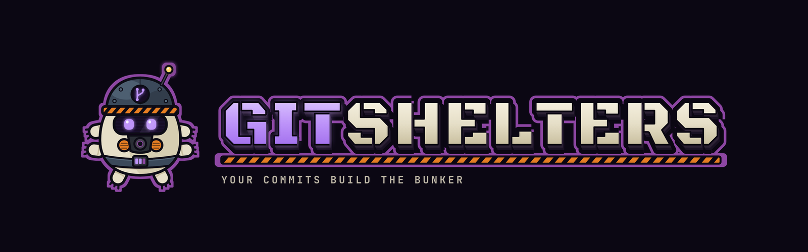
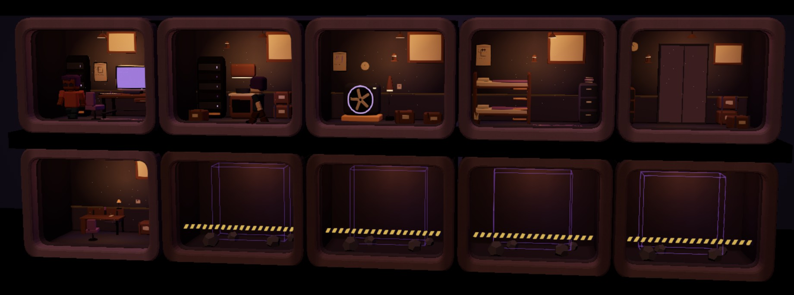
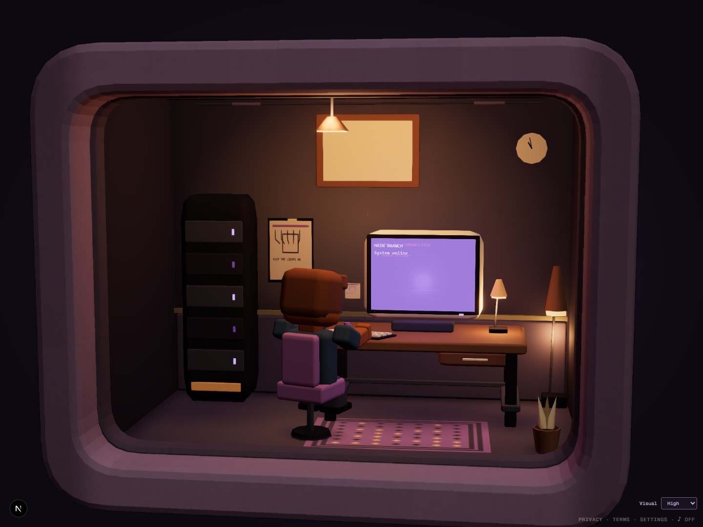
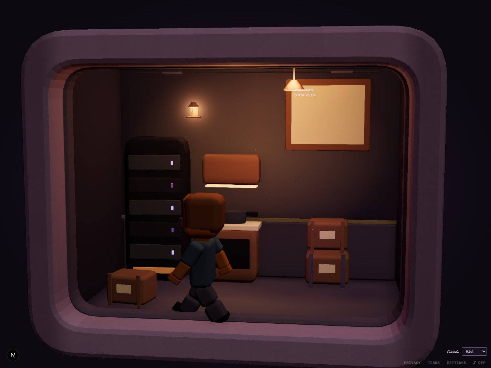
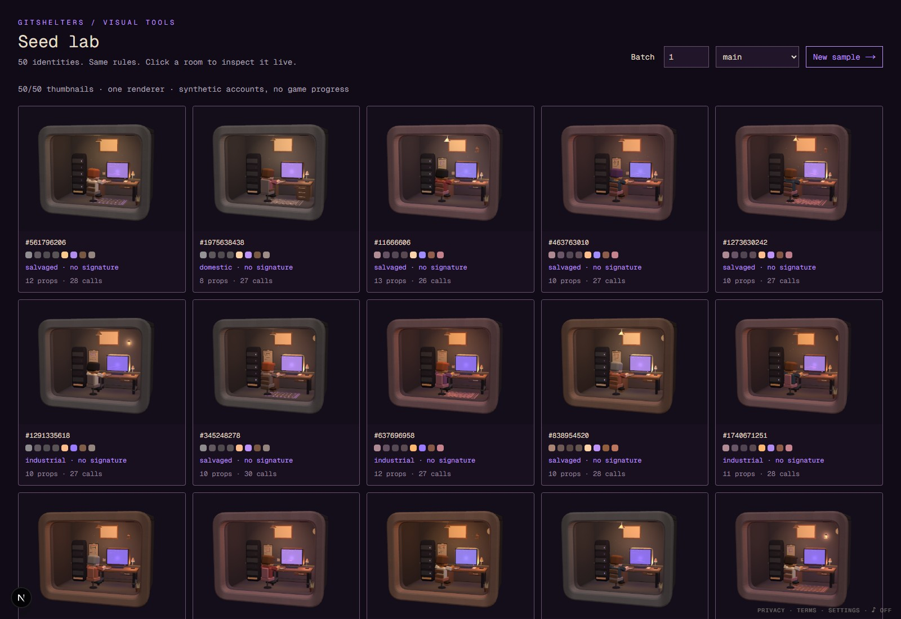

<p align="center">
  
</p>

<p align="center">
  <strong>Your commits build the bunker. Your idle still earns. Your absence is canon.</strong><br />
  An idle base-builder where real GitHub activity feeds a post-apocalyptic bunker.
</p>

<p align="center">
  <a href="https://gitshelters.com">Play the alpha</a> ·
  <a href="https://gitshelters.com/map">The 404 Lands</a> ·
  <a href="./DESIGN.md">Design &amp; roadmap</a> ·
  <a href="./docs/art-guide.md">Art guide</a> ·
  <a href="./CONTRIBUTING.md">Contributing</a> ·
  <a href="./docs/adr/">Decisions</a> ·
  <a href="./devlog/">Devlog</a>
</p>

<p align="center">
  <a href="https://github.com/GuiBarradas/git-shelters/actions/workflows/ci.yml"></a>
  <a href="./LICENSE"></a>
  
</p>

---

## The game

There was the **Great Merge Conflict**: late one Tuesday, every public repository on the planet went into conflict at once. What is left of the internet is the **404 Lands**. The people who made it are **Maintainers**, holed up in their **Repos** with old batteries and a local clone of Wikipedia. You are one of them.

- Your public GitHub pushes earn **Bytes** inside the bunker, with daily caps and anti-cheese checks.
- Bytes build rooms. Rooms give your survivors, the **Forks**, work: a Cook in the Cache Storage, an Engineer on the Power Plant, a Tinkerer at the Workshop bench.
- **Cache** (food) and **Uptime** (power) are simulated while you are away. No engineer, and the lights go out.
- A **Daily Event** arrives on the Main Branch terminal every day. You decide; the crew reacts.
- The Forks feel your commit log. Push today and they are happy. A week of silence and they get bitter, and they say so when you poke them.
- Badges land on your public profile. Every bunker is a dot on the map of the 404 Lands.
- A welcome packet and first-steps guide help you get started. Before you leave, check the next event and an eight-hour resource forecast.

The Alpha has **10 slots across two floors**, including the Main Branch. Build a Cache Storage, Power Plant, Dorm, Elevator or Workshop; recruit additional Forks for **200 Bytes** each and assign them to work. Combat, expeditions and trading are still planned. See the [design and roadmap](./DESIGN.md) for the current scope.

## Inside the bunker

Warm lamps, violet terminals, worn concrete and residents at work: the bunker is a small diorama of life after the internet.

<p align="center">
  
</p>

<p align="center">
  
  
</p>

*In-engine captures, October 2026. Scene Lab fixtures with synthetic residents, seed `583231`, High preset; these are demonstration scenes, not live player statistics.*

- **A recognizable home.** The stable numeric GitHub **account ID** seeds the palette, concrete wear, furniture, resident appearance and occasional signature props. Renaming the account keeps its identity. Each player owns one bunker; Forks are its residents.
- **Rooms with life.** Procedural posters, notes, rugs and screens join contextual work animations, blinking LEDs, steam and moving machinery.
- **Continuous navigation.** Click a room to zoom in, then return to the corridor. The same renderer stays alive while the room's controls load.
- **Adjustable visuals.** Low, Medium and High presets control postprocessing. High adds ambient occlusion and depth of field in close-ups.
- **Shareable rooms.** Capture a room for a profile card with current Bytes balance, living Forks and built rooms. Uploads require the Storage migration described below.

The [Seed Lab](https://gitshelters.com/seed-lab) previews **50 deterministic identities** at a time. Compare room types and palettes, inspect a room live, or download its JSON recipe.

<p align="center">
  
</p>

## How it is built

The 3D scene uses procedural geometry, bevelled concrete frames, Standard-derived materials and canvas texture atlases, with no external 3D models. A low-FOV perspective camera frames the bunker like a diorama. Static geometry is merged and repeated room details are instanced; local lighting gives amber lamps and violet screens their color. Read-outs remain plain HTML pinned to the scene.

Visual recipes use **cyrb53 + mulberry32**, with independent random streams for each domain and snapshot tests for determinism. Visual identity changes presentation, not room costs, recruitment or the economy. Repository-language themes and real commit/README excerpts are supported generator inputs, but are not fetched for account bunkers.

The game is deliberately server-authoritative and boring where it counts:

- **Bytes are a ledger.** Every credit and debit is a row with a unique `(user, source, ref)` key, so a push is paid once no matter how many syncs race. Balances are materialised, never recomputed.
- **The economy is a pure function.** `simulate(state, workforce, hours)` runs once when you show up and is written back with an optimistic guard. One tick of three hours equals three ticks of one hour, and the test says so.
- **Everything derived stays derived.** Mood comes from the last push, badges from state the game already has, a bunker's spot on the map from a hash of the login. Nothing is stored that can be computed.
- **Postgres decides.** Costs, caps, the bed count and the elevator gate live in SQL functions with row locks; the TypeScript catalog mirrors them for the UI.
- **Public by construction.** A profile shows exactly the fields one mapper copies out, and a CI test feeds that mapper every sensitive field we could think of and asserts none survive.

| Layer | Tech |
|---|---|
| Runtime | Next.js 16 App Router · React 19 · TypeScript 5 (strict, `noUncheckedIndexedAccess`) |
| 3D | Three.js r184 · React Three Fiber · Drei · pmndrs postprocessing |
| UI | Tailwind v4 · HTML room panels · Silkscreen share cards |
| Backend | Supabase (Postgres, RLS, Auth, Storage) · Server Actions · GitHub Actions sync |
| Audio | Two `<audio>` elements and a preference in localStorage |
| Tests | Vitest (unit and integration against a throwaway user) · Playwright |
| Quality | ESLint with the React Compiler rules · Husky · lint-staged · Sentry |

**Performance is still Alpha work.** Start with Low on integrated GPUs. The 30-room / 36-resident stress fixture measured about **162–166 draw calls** on Iris Xe, but the **60 FPS target is not met** in the current procedural scene. That fixture exceeds the playable 10-slot bunker; physical mobile performance is still unverified. See the [art guide's measurements and limits](./docs/art-guide.md#12-procedural-bunker-identity).

## Running it

You need Node 22+, pnpm 10+ and a Supabase project (the free tier is enough).

```bash
git clone https://github.com/GuiBarradas/git-shelters.git
cd git-shelters
pnpm install
cp .env.local.example .env.local   # then fill it in
pnpm exec supabase login
pnpm exec supabase link --project-ref YOUR_PROJECT_REF
pnpm db:push                      # applies migrations to your linked project
pnpm db:types                     # regenerates the database types
pnpm dev
```

Use your own Supabase project. Open `http://localhost:3000` after configuring GitHub sign-in.

| Variable | What for |
|---|---|
| `NEXT_PUBLIC_SUPABASE_URL`, `NEXT_PUBLIC_SUPABASE_ANON_KEY` | the browser client |
| `SUPABASE_SERVICE_ROLE_KEY` | server-only writes (ledger, sync, badges) |
| `GITHUB_TOKEN` | optional public-data token for a higher GitHub API rate limit |
| `CRON_SECRET` | shared secret for `/api/cron/sync` |
| `SENTRY_*` | optional; errors go nowhere without them |

For [GitHub OAuth](https://supabase.com/docs/guides/auth/social-login/auth-github), set the GitHub app's callback to `https://YOUR_PROJECT_REF.supabase.co/auth/v1/callback`, then enter its client ID and secret in Supabase's GitHub provider. Add `http://localhost:3000/auth/callback` to Supabase's allowed redirect URLs, plus your deployed app's callback URL when hosting it.

Scheduled sync runs through [GitHub Actions](./.github/workflows/sync-cron.yml). Set repository secret `CRON_SECRET` to match the deployed app's environment variable, and repository variable `APP_URL` to its base URL. The workflow requests a run every 15 minutes; actual delivery can be delayed. Manual **Sync** remains available in the game.

**Share-card setup:** apply [the bunker previews migration](./supabase/migrations/20261013234423_bunker_previews.sql) to create the private Storage bucket and policies. Without it, uploads are unavailable and public cards use a fallback. Applying it to production remains a deployment task.

| Script | What it does |
|---|---|
| `pnpm dev` | dev server |
| `pnpm build` · `pnpm start` | production build and server |
| `pnpm test` | unit tests, no network |
| `pnpm test:integration` | against your Supabase project, with throwaway users |
| `pnpm test:e2e` | Playwright |
| `pnpm lint` · `pnpm typecheck` | full lint and type checks; pre-commit lints staged files and checks all types |
| `pnpm db:new <name>` | a new migration file |

Visual review routes:

- `/seed-lab` — 50 account identities, room inspection and JSON export.
- `/dev/scene-lab?overview=1&seed=583231` — bunker overview and room zoom.
- `/dev/scene-lab?room=main&seed=583231&quality=high` — one room in detail.
- `/dev/scene-lab?rooms=30&seed=583231&quality=low` — rendering stress fixture.

Scene Lab is available in development; production review builds require `SCENE_REVIEW_BUILD=1`. These tools use synthetic data and do not create player progress.

## Where things live

```
src/app/            routes, Server Actions, the cron and API handlers
src/components/     scene/ (the bunker, rooms, Forks), hud/, intro/, audio/, map/
                    scene/procedural/ (props, texture atlas, Seed Lab, captures)
src/lib/            economy/ (tick, away report), forks/ (catalog, mood, jobs),
                    visuals/ (seeded recipes, slots, share cards), badges/,
                    regions/, github/ (sync), anti-cheese/, api/ (public reads)
supabase/migrations one file per change; SQL functions are the authority
docs/adr/           why things are the way they are
DESIGN.md           the public summary of the design
docs/art-guide.md   how to draw a room that belongs in this bunker
docs/screenshots/  current in-engine README captures
devlog/             the story of the design, in the open
```

## Contributing

Issues and pull requests are welcome, from a typo in a Fork's line to a whole room. Start with [CONTRIBUTING.md](./CONTRIBUTING.md): it explains the setup, the conventions, and how to add a room, a badge or a dialogue line without touching anything else. The [art guide](./docs/art-guide.md) is the current reference for visual work.

## Credits

Design, code, words and 3D by [Guilherme Martins Barradas](https://github.com/GuiBarradas). Brand art by the author. Music: "Uncontained" by Alana Jordan; ambience "The Shining Ambience" by Mezhdunami and "The Foyer Mirror" by turning_pages, all under the Pixabay Content License.

Silkscreen is bundled under the [SIL Open Font License](./public/fonts/silkscreen/OFL.txt).

## License

Code: [AGPL-3.0-only](./LICENSE). Run it, fork it, improve it; if you host a modified copy as a service, publish your source under the same terms.

Content: the name Git Shelters, the setting, the names of places, survivors, traits and rooms, the Daily Event texts, the brand and the visual identity are not covered by the AGPL and remain with the author. Ask before reusing them. See [ADR 0009](./docs/adr/0009-license-agpl-code-reserved-content.md).
