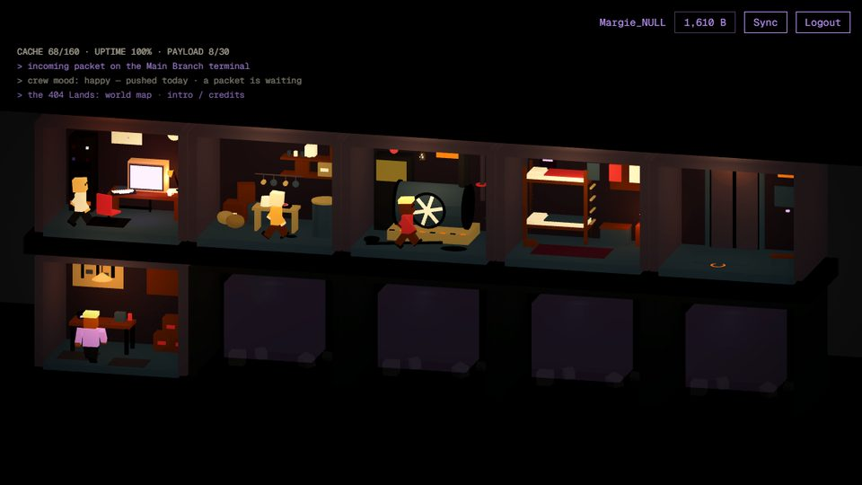
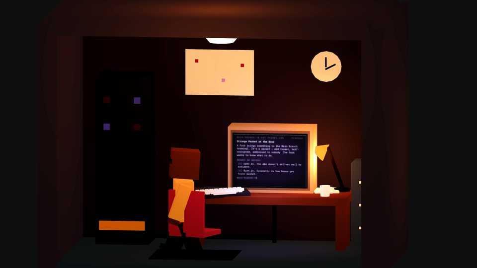
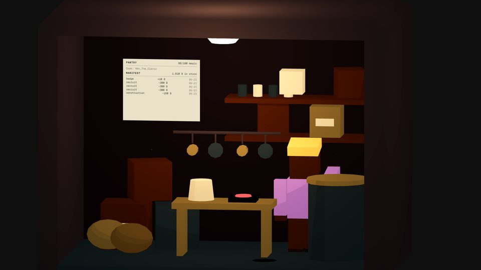
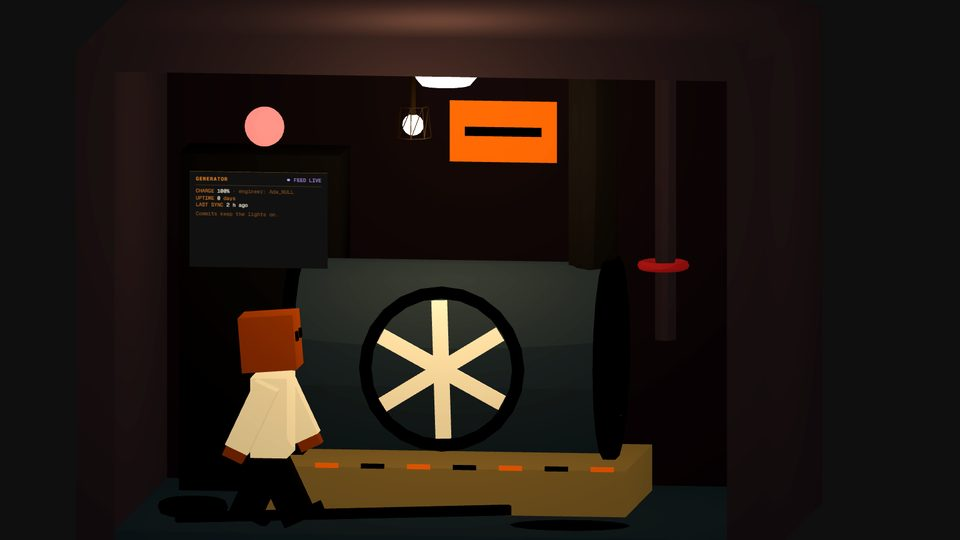
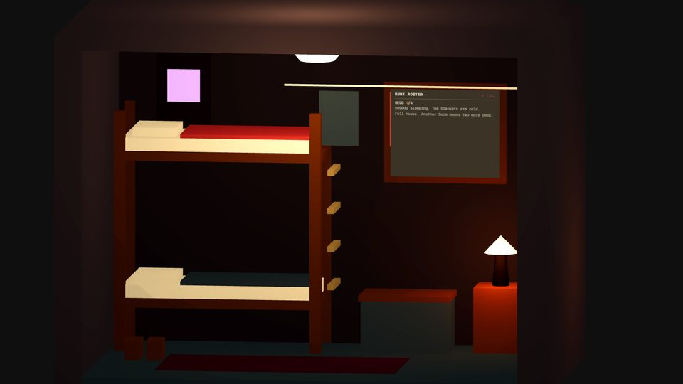
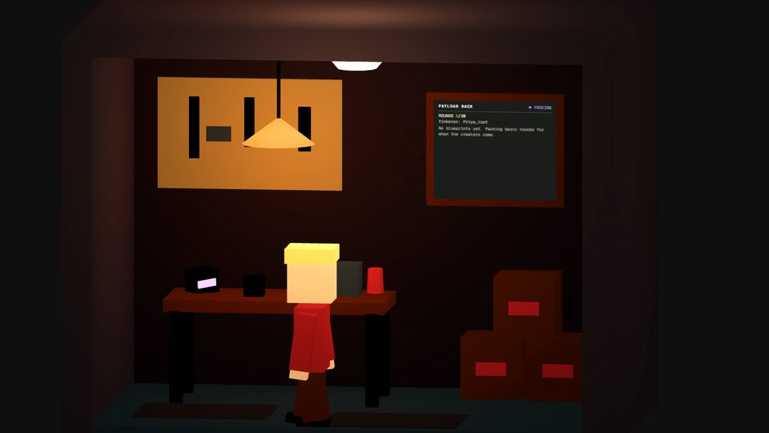
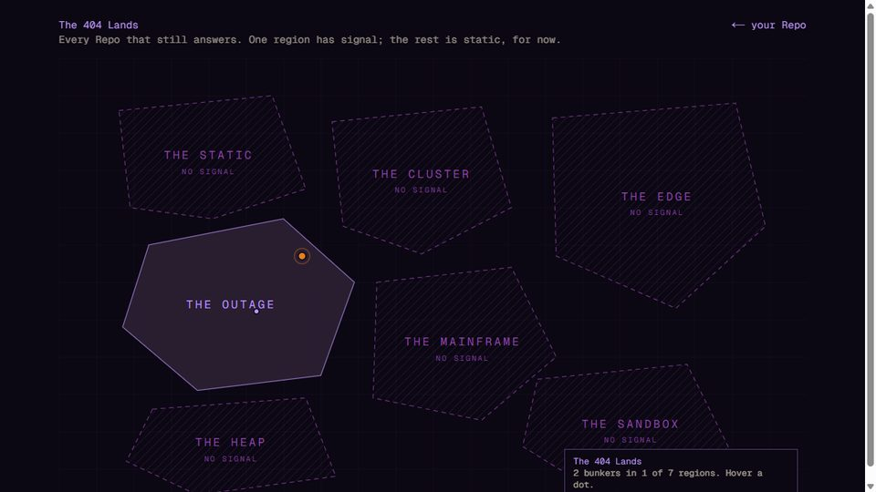

# Git Shelters art guide

The contract for anything visual in the game: the world, the rooms, the Forks, the interface and the brand. If a picture is not covered here, ask before drawing it. Also available as a [PDF](./art-guide.pdf).

## 1. Pillars

1. **A dollhouse cut open.** The bunker is a cross-section: rooms side by side, open at the front, seen from slightly above and to the right by a low-FOV perspective camera (28 degrees). Depth exists but the reading is frontal. Nothing important hides behind anything.
2. **Soft low-poly diorama.** Use three.js primitives, shared low-segment rounded boxes and a rounded extruded room rim with `DioramaMaterial` (Three Standard plus local diffuse lighting). Curves belong to silhouettes: hulls, cushions, containers and furniture edges. No imported models. Surface marks use one shared 1024 × 512 SVG atlas with cutout materials; keep UVs when batching. Basic materials are reserved for indicators and inexpensive vertex-colour light pools.
3. **Warm inside, violet where it glows.** Rooms are lit by warm lamps. Violet belongs to screens, LEDs, indicators and the interface. A violet lamp is a mistake.
4. **Lived in, not pretty.** Clutter tells the story: a mug, a cable bundle, boots by the bunk, a working wall clock. Everything looks scavenged, repaired, labelled by hand.
5. **Dry humour, no gore.** The apocalypse is a merge conflict. Danger is a blinking beacon and a hazard stripe, never blood.

## 2. Palette

The tokens live in `src/lib/palette.ts` and `src/app/globals.css`. Use them by name; do not invent hex values in components unless it is a one-off shade of an existing token.

| Token | Hex | Use |
|---|---|---|
| `bunkerBlack` | `#0B0713` | page and panel background, the earth |
| `inactivePlum` | `#2D2235` | unbuilt cells, inactive blocks, map regions |
| `phosphorViolet` | `#BD93F9` | interface text, borders, screens, LEDs, emissives |
| `violetDim` | `#8D46A3` | dim borders, glows, locked things |
| `amber` | `#E67E22` | calls to action, warnings, the active Main Branch lamp, the Maintainer's own dot |
| `lampWarm` | `#FFC98A` | every room lamp |
| `concrete` | `#45414F` | beams, pillars, shell |
| `concreteTan` | `#8B7E5A` | furniture, cabinets, small props |
| `oldWoodBrown` | `#5C3A21` | desks, bunks, crates |
| `steelBlue` | `#3A4A5A` | floors, drums, steel |
| `boneWhite` | `#E6DFC8` | body text, paper, mattresses, mugs |
| `fadedRed` | `#A14545` | danger, the chair, blankets |
| `mustardWarning` | `#D4A24C` | sparingly: a crate, a shirt |
| `glowYellow` | `#FFD66B` | the idle Main Branch lamp, a helmet |
| `coalBlack` | `#0F0F0F` | black objects |

Rules: no green anywhere. Amber is the only warm accent in the interface. Text on the background is `boneWhite` for prose and `phosphorViolet` for anything the game says.

## 3. Light

- The overview uses cool hemisphere fill, a warm directional light and two analytical local sources in `DioramaMaterial`, evaluated per vertex and interpolated across surfaces. This is approximate diffuse lighting, not a baked lightmap or occlusion solution. Subdivide broad walls enough to keep gradients smooth. Procedural concrete noise runs only on the hull. Shared discs provide contact shade; additive pools are only a faint accent. `RoomLight` enables a few actual, unshadowed prop lights only in close-up.
- In close-up, the shell light and one or two prop lights strengthen the shader lighting. Keep amber sources near a visible fixture and violet near a screen, with short range and decay 2. Do not add shadow-casting point lights per room.
- Screens, LEDs and indicators glow through `emissive`, not through lights, except the Main Branch screen which also tints the desk with a small violet point light.
- A dark bunker is a feature. When `powered` is false, lamps drop to about 12% and emissives go to zero. Every room takes a `powered` prop and must read as dead without it.
- The green terminal is gone. Screens are violet phosphor on `#150a26`.

## 4. Space and scale

A cell is 4 wide, 3 high, 3 deep, centred at the origin; the floor is y = 0, the back wall's face is at **z = -1.25** (the shell's wall is 0.25 thick from z = -1.5). Anything on the wall sits at z ≥ -1.22 or it is inside the wall and invisible. Pillars stand at x = ±2.1; keep props inside x = ±1.85.

A Fork is about 1.45 tall. Waist height is 0.66 (desks), seat height 0.3 to 0.5, shelves from 1.4 up. A survivor's head must clear a bunk, a lamp shade and the bottom of any HTML read-out.

## 5. A room's anatomy

Every interior exports three things and registers them in `src/components/scene/rooms/index.tsx`:

- **`LAYOUT`**: a walk lane (`{ z, xMin, xMax }`, usually z ≈ 1.1, the front strip) and a list of stations. The lane is furniture-free by contract; a Fork enters a station straight from the lane along z and leaves the same way. A station has a position (feet), a facing, an action (`sit`, `type`, `work`, `inspect`, `cook`, `crank`), a hold time, and for sitting a `seatY`.
- **A panel anchor**: where the room's HTML read-out is pinned (position, width, height). One world unit is 40 CSS pixels. The read-out is DOM over the canvas: it paints over everything, so keep stations out of its screen area or a Fork will vanish behind text.
- **The interior component**: `<RoomShell light lightIntensity powered>` and children. Read `MainBranchRoom.tsx` first; it is the reference for density.

Density target: one hero object (the terminal, the drum, the bunk, the bench, the shaft), two or three secondary objects, and five to ten pieces of clutter. Group related primitives so they move together.

Performance targets: 60 fps on integrated graphics, 30 fps on a midrange phone, and fewer than 300 draw calls for the isolated 30-room fixture. These are targets, not guarantees. `SceneInstances` shares repeated geometry across rooms and moving Fork pivots. Original meshes remain available for raycasting; meshes that animate their own visibility or material use `LIVE`. Contact shade draws before additive glow; arbitrary transparent meshes remain independent. `StaticBatch` first merges static room props by compatible material; `SceneInstances` then instances the repeated room templates. Forks skip the first merge so different outfits can still share instanced limb geometry. No realtime shadow maps.

Quality presets: **Low** disables postprocessing and dust/steam, uses a cheaper diffuse response in the overview, caps overview DPR at 1 and can adapt down to 0.75. Close-ups retain Standard material response and their local lights in every preset. **Medium** adds HDR bloom (threshold 1.15), ACES tone mapping, SMAA, vignette and faint grain. **High** adds half-resolution N8AO and mild, target-focused DOF only in close-up; close-up DPR is 1.5. The renderer uses ACES directly without post; the composer has its own ACES effect and performs the final colour conversion. Avoid applying tone mapping twice.

Use `/dev/scene-lab?rooms=30&quality=low` for 30 rooms / 36 Forks, `rooms=10` for ten rooms / twelve Forks, `room=main` for the terminal, `room=empty` for the build hologram, and `overview=1` to check the real overview camera and click transition with local fixture data. This route is development-only unless explicitly enabled with `SCENE_REVIEW_BUILD=1` for a local production benchmark. It does not expand gameplay slots or persist data. Run `node scripts/inspect-scene.mjs <url> <screenshot.png>` against a production build and record GPU, resolution, full-frame draw calls and frame times. Do not run compilation or other GPU tests concurrently. A desktop viewport emulating a phone does not validate phone GPU performance.

Surface detail: `public/textures/shelter-details.svg` is one shared 1024x512 atlas (eight padded tiles). `SurfaceDetail` uses two triangles per mark, cutout alpha and existing lights; instancing preserves UVs and shares repeated marks across rooms. Use it for wear, fabric seams, keepsakes, workshop markings and service panels. Assigned Forks strengthen warm pools and the violet hull indicator; empty rooms dim those accents, and power loss turns the indicator amber. Occupancy does not imply production or an upgrade tier.

**Production validation, 2026-10-13:** Intel Iris Xe / ANGLE D3D11, Chromium, 1920×1080 viewport, 600 frames after warm-up. Internal resolution stayed stable during each sample; no browser errors.

| Fixture / preset | Internal resolution | Mean frame time / FPS | p95 | Max | Frames >25 ms | Draw calls |
| --- | --- | --- | --- | --- | --- | --- |
| 30 rooms, 36 Forks / Low | 1920×1080 | 16.67 ms / 60.0 | 16.8 ms | 17.1 ms | 0 | 113 |
| 10 rooms, 12 Forks / Medium | 1440×810 | 25.17 ms / 39.7 | 33.4 ms | 33.8 ms | 306 | 89 |

The 60 fps desktop target is validated for Low on this GPU, not for Medium or High. Medium's postprocessing remains a measurable cost. Physical phone performance is still unmeasured; only the 390×844 layout was checked. Visual checks covered all three close-up presets, construction previews, and the overview-to-room click transition without browser errors. The reference still has richer indirect light, cast shadows and material wear; the runtime uses approximations to stay within budget.

**Fork silhouette follow-up, same day:** after refining the hair, hard hat and elbows, the 30-room Low fixture uses 116 draw calls. Two 600-frame samples measured 29.31 and 26.28 ms at 1440×810. A controlled old/new/old comparison in the same production build and browser (360 frames each, 20-second warm-up, same resolution) measured 22.78 / 24.03 / 22.87 ms; p95 was 33.4 / 33.5 / 33.4 ms. The new model added about 5% frame time in that comparison, while neither model reproduced the earlier 60 fps sample. Treat 60 fps as demonstrated in the earlier sample, not a stable guarantee; repeat under controlled system load before claiming it for this revision.

**Historical baseline — 2026-10-05:** Intel Iris Xe / D3D11, ten rooms and twelve Forks, 1920×1080 viewport with stable 1440×810 internal resolution. Over 600 frames after warm-up: mean 16.67 ms (~60 fps), p95 16.9 ms, max 17.8 ms, 180 draw calls per frame, no browser errors. This is a short measurement on one integrated GPU, not a guarantee for every notebook.

**Historical atlas pass — same date:** production build, same GPU, viewport, full bunker and 1440x810 internal resolution; 190 draw calls and no browser errors. The 600-frame checks did **not** reproduce 60 fps in this session (mean 39.25 ms in the first run). A diagnostic on/off/on draw comparison measured 25.28 / 25.08 / 31.72 ms, with 190 / 180 / 190 calls. The first pair showed little atlas cost, but the changing frame times make this inconclusive as a regression benchmark. The October 13 results above supersede this measurement for the current visual implementation.

  
  

  
  

## 6. The Forks

A Fork is voxels of 0.2: a large, softly bevelled head, continuous hair volume covering crown, temples and nape with a short fringe, torso, two arms with elbows, two legs with knees, hips at 2.2 voxels. Hair must read as one silhouette from the back, never as a slab over a bare head. Hard hats have a crown, brim and centre rib. Skin, shirt, trousers and an optional helmet come from the Fork's seed through `forkLook()`; shirts draw from the palette. Mood changes motion, not shape: speed, head pitch and bounce in `MOOD_MOTION`. When sitting, the model's origin drops so the hips land on `seatY`; check hand-to-keyboard contact in a screenshot, never by reasoning alone. Review front, side, back and three-quarter views at `/dev/scene-lab?forks=1`, then check the actual room and overview. Forks start at task stations, then alternate tasks and short walks, with seed offsets for breathing, blinking and arm motion. These animations do not change production or stats.

Do not add faces beyond the two eyes, and do not add animations that are not driven by the behaviour loop.

## 7. Interface

- One monospaced font everywhere. Uppercase with wide tracking for labels, sentence case for lines the game says, `>` as the prompt prefix.
- Panels are `bunkerBlack` at 90 to 95% with a one-pixel `phosphorViolet` border at 40 to 60%. No rounded corners, no shadows except the CRT's inner shadow.
- The CRT (`.crt`) is for terminals only: the Main Branch screen and the intro. Scanlines, vignette, a slow flicker. Do not put it on ordinary panels.
- Notices that fade (`.hud-fade`) are for one-shot facts: a build result, a badge, a sync outcome. Persistent state goes in the HUD lines at top left.
- Amber marks the thing you can do. Red marks the thing that went wrong. Violet is everything else.

## 8. Brand

The lockup (mascot plus wordmark), the wordmark and the mascot live in `public/brand/` as transparent PNGs, with the sources in `assets/`. Use the lockup on dark backgrounds only, never smaller than 320 pixels wide, with clear space equal to the mascot's height around it. The mascot on its own may be used as an icon; the pixel version (`mascot-pixel.png`, 56 pixels, rendered with `image-rendering: pixelated`) is for terminal moments like the intro.

The brand is not under the code license. Do not restyle it, recolour it or put it next to other logos as if it endorsed them.

## 9. The world

The 404 Lands are seven regions. Only The Outage is open in the alpha; the others are drawn locked, hatched, "no signal". When a region opens it gets a theme: wall tone, lamp colour, one or two signature props, and a hatch pattern on the map. The intended vibes, from the design document:

| Region | Vibe | Signature |
|---|---|---|
| The Outage | total blackout, emergency lighting | black walls, red beacons, sirens |
| The Static | white noise, ghost broadcasts | distorted CRTs, lo-fi melancholy |
| The Heap | memory never collected | piles of old hardware, nostalgia |
| The Cluster | feral data centers | server racks, cold blue, corporate decay |
| The Mainframe | ruins of the megaservers | beige terminals, magnetic tape, IBM seventies |
| The Sandbox | nothing behaves twice | walls that shift colour, controlled glitch |
| The Edge | where the maps stop | clean sci-fi minimalism, frontier |

## 10. Do and do not

**Do**: reuse a palette token; add clutter; light with a warm lamp; test a pose with a screenshot; keep stations off the read-out; name a prop for what it is in the world.

**Do not**: import a model or add per-prop textures; use green; light a room violet; put a prop inside the wall; add an unconditional postprocessing pass or per-room shadow map; reference any other game's assets, names or trade dress; add a face, a logo or a text mesh.

## 11. Checklist for a visual PR

- [ ] Palette tokens only.
- [ ] Wall props at z ≥ -1.22; nothing beyond x = ±1.85.
- [ ] Reads at corridor scale and at room scale (two screenshots attached).
- [ ] Reads with `powered` false.
- [ ] A Fork walked through it for a minute without crossing furniture.
- [ ] The HTML read-out does not cover a station.
- [ ] Sixty frames per second on an integrated GPU (headed Chrome, not headless).

## 12. Procedural bunker identity

The identity belongs to the **GitHub account**, using the numeric `users.github_id`. A renamed login must keep the same bunker. Forks remain recruited residents; room purchases, resources and recruitment rules are unchanged. Invalid legacy IDs use the authored neutral scene, never a substitute hash of the login or database UUID.

`src/lib/visuals/` produces serializable recipes with cyrb53 and mulberry32. Palette, wear, furniture, residents, signatures, room slots and textures use independent streams. Version a changed domain without reseeding the others. Resident appearance is keyed by the resident's stable ID; sorting the roster cannot change outfits. The identity snapshot lives in `tests/unit/lib/visuals/__snapshots__/`.

The four harmonic palette families are rose, plum, clay and warm slate. Keep lamps amber/peach and CRTs violet. Furniture variants reuse normalized authored geometry. Rare signatures (aquarium, cat, flag) occur in about nine percent of identities. Slots carry placement tags, support relationships and rotated bounds; every room has 8–15 recognizable props and a visible light. The front walking lane stays clear. Keep the Main Branch chair off the HTML screen axis. Read-out boards are mandatory with fixed dimensions so a seed cannot hide or shrink the game's information panels.

Posters, notes, rugs and screens share a canvas atlas per bunker, disposed with the scene. Real commit/README excerpts and language themes are supported inputs, but are **not fetched for an account with no selected repository**. Missing input uses fictional terminal copy, never a fabricated commit. Owner and public views read the same credited-activity timestamp for lamp activity. This is presentation only.

`/seed-lab` renders 50 reproducible sample identities with one queued offscreen renderer; completed thumbnails are PNGs, and only the selected inspection opens a live scene. Batch and room-kind controls reproduce a sample. Download JSON to retain a problematic recipe. `/dev/scene-lab?seed=583231&rooms=30&quality=low` exercises the larger procedural fixture without creating game data.

The sharing flow renders a real 960×720 room into a WebGL render target. An authenticated upload stores only that PNG; `/api/u/[login]/card` composes a 1200×630 image with server-read balance, living residents and built rooms. The public profile uses that route as its `og:image`. Missing captures produce an explicit fallback. Apply `20261013234423_bunker_previews.sql` before enabling uploads in a deployment; the private bucket and owner policies are required. Account deletion removes the stored capture first. Silkscreen is bundled with its OFL license under `public/fonts/silkscreen/`.

Validation on 2026-10-13: 277 unit tests passed, including generator snapshots, placement invariants and sharing/authentication checks; the ten batching/instancing tests also passed after reindexing merged geometry. Chromium rendered 50 identities for each of the six room types (300 thumbnails), with no page errors and no remaining thumbnail canvas after each queue. Native inspection dialogs support Escape and contain keyboard focus.

On an Intel Iris Xe, ANGLE D3D11, Low, 1440×810 internal resolution, the 30-room / 36-resident fixture measured **166 draw calls, 39.72 ms mean and 50.20 ms p95** over 600 frames before the final read-out adjustment. The 10-room / 12-resident fixture measured **74 draws, 35.19 ms mean and 50.10 ms p95**. The final read-out pass registered about **162 draws**, but DPR changed during sampling and one frame stalled for 6.38 seconds; do not use that run as a steady-state FPS measurement. The draw-call budget is met, **the 60 FPS target is not**. A preceding comparison measured 36.97 ms for the procedural scene and 44.47 ms for the authored scene under the same protocol; machine load varies substantially, so do not present these as a controlled speedup. Physical mobile performance remains unverified. The Storage migration has not been applied to production or validated against local Postgres (Docker unavailable).
